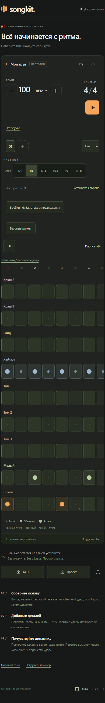

# SongKit

Текущая версия разработки: **0.4.0-rc.1**. Опубликованная версия в `main`: **0.3.0**. Изменения готовятся в [PR #18](https://github.com/SergeSokolan/songkit/pull/18); кандидат релиза не означает обновление GitHub Pages.

Барабанный редактор PWA: 4/4, 1–4 такта, девять инструментов, прямые и триольные сетки, динамика, Undo/Redo, воспроизведение, локальный черновик, MIDI/JSON, офлайн. Без аккаунта, аналитики и передачи партий.

## Запуск

Node.js — версия из `.node-version`. В PowerShell:

```powershell
npm ci
npm run dev
```

Для production и офлайна:

```powershell
$env:BASE_PATH = '/songkit/'
npm run build
npm run preview
```

Откройте `http://localhost:4173/songkit/`. Для Service Worker нужен HTTPS или localhost; обычный HTTP в локальной сети на iPhone не обеспечивает офлайн-режим.

## Управление

- Касания клетки: пусто → обычный → тихий → пусто. Удержание не открывает меню.
- «Изменить / перенести удар» → клетка: динамика, акцент, удаление или перенос на той же дорожке. Drag мышью также доступен.
- Треугольник запускает, два столбика ставят на паузу с сохранением позиции. Обе кнопки — только иконки, с именами для скринридера. Кнопки «В начало» нет.
- Прямые сетки 1/4–1/32; 1/8T и 1/16T — 3 и 6 ударов на долю. Переключение не меняет ноты. Счётчик показывает события между делениями текущей сетки.
- На телефоне полные названия над рядами, закреплены при горизонтальной прокрутке. На компьютере — слева. Томы сверху вниз 1/2/3, бочка внизу.
- «Брейки»: выбранный такт → жанр → ¼/½/1 такт → карточка → предпросмотр → применение. 33 оригинальных варианта; генератор и произвольный участок — в дополнительном режиме.
- «Базовые ритмы»: 15 вариантов, по три для рок/металл/поп/фанк/джаз. Применяются к выбранному или всем тактам, темп сохраняется. Недостающие инструменты добавляются с явным разрешением.
- Предпросмотр не меняет сохраняемый проект. Применение отменяется одним Undo. Черновик сохраняет подтверждённую партию и вид редактора; история Undo между запусками не сохраняется.
- JSON — перенос и резервная копия; MIDI передаёт точные ticks и velocity. Импорт v1/v2 поддерживается. Очистка данных браузера удаляет локальный черновик.

Точные музыкальные схемы и источники: [брейки](docs/FILL-CATALOG.md), [грувы](docs/GROOVE-CATALOG.md). Звуки пока оригинальные синтезированные, не акустический банк. Слуховая музыкальная оценка человеком и реальный iPhone ещё требуют ручной приёмки.

## Текущий интерфейс

[Телефон 360](docs/screenshots/after-360.png) · [390](docs/screenshots/after-390.png) · [430](docs/screenshots/after-430.png) · [все дорожки](docs/screenshots/full-kit-390.png) · [компьютер](docs/screenshots/desktop-1280.png).



Скриншоты сняты в Chromium, не на настоящем iPhone. Версия и измерения: [описание снимков](docs/screenshots/README.md).

## Проверки и обновление документации

```powershell
npm run check
npx playwright install chromium webkit
npm run test:e2e
npm run docs:screenshots
npm run format:check
```

Перед E2E и снимками нужна production-сборка с `BASE_PATH=/songkit/`. `check` проверяет форматирование, согласованность версии/lockfile/changelog/снимков, lint, типы, FSD/циклы, coverage, сборку и бюджеты. Снимки обновляются после изменения интерфейса или номера версии; перед коммитом их нужно просмотреть. Подробности: [тестирование](docs/TESTING.md).

## Версии и публикация

[CHANGELOG](CHANGELOG.md) содержит изменения по версиям со ссылками сравнения; те же заметки доступны в [GitHub Releases](https://github.com/SergeSokolan/songkit/releases). [RELEASING](docs/RELEASING.md) описывает SemVer, аннотированные теги `vX.Y.Z`, кандидаты `vX.Y.Z-rc.N` и GitHub Releases. Версия в футере берётся из `package.json`; Pattern v2 и Draft v1 — независимые схемы данных.

Изменения проходят PR и CI. `main` после зелёного verify публикует тот же проверенный артефакт при `PAGES_ENABLED=true`. Адрес: [SongKit](https://sergesokolan.github.io/songkit/). Тег или prerelease сами по себе Pages не обновляют. Для слияния текущего PR ранее было запрошено отдельное подтверждение; оно пока не получено.

## Звук на iPhone

Если нет звука, проверьте беззвучный режим и громкость медиа. «Нет звука?» → «Восстановить звук» пересоздаёт аудиоконтекст и запускает тест без изменения нот. Приложение запрашивает playback через доступный Audio Session API, но не определяет, слышит ли пользователь звук. После сворачивания продолжение только по нажатию Play.

После обновления закройте все вкладки SongKit и PWA, затем откройте с интернетом. Версия видна внизу. Не удаляйте данные браузера для обычного обновления. Реальный Safari/PWA проверяется отдельно от WebKit-эмуляции.

## Документация и дальнейший объём

[Спецификация](docs/SPEC.md) · [архитектура](docs/ARCHITECTURE.md) · [решения](docs/DECISIONS.md) · [отчёт бэклога](docs/BACKLOG-2026-10-27.md) · [следующая работа](docs/SOL-HANDOFF.md).

Остальные размеры, нотация, акустический банк, MusicXML и MP3 — следующие этапы. Подбор аккордов не входит в текущую реализацию.
